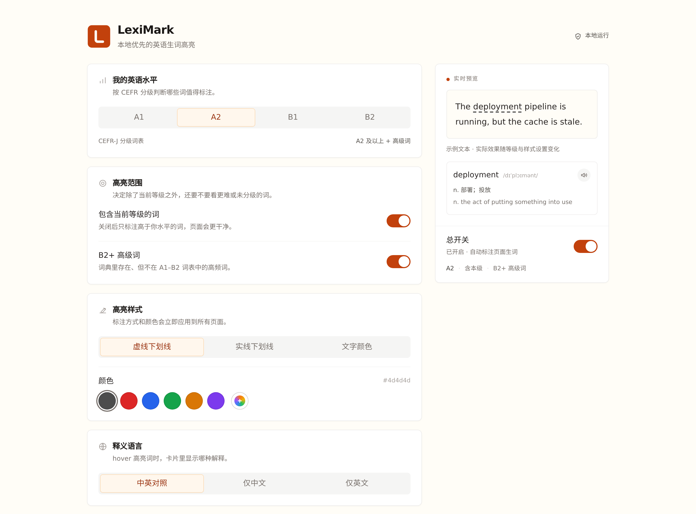
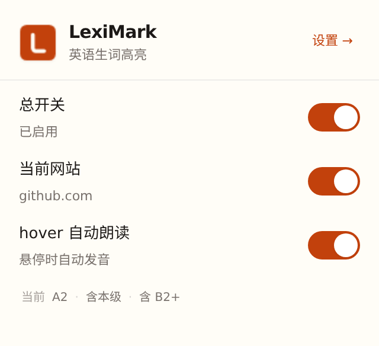

<p align="center">
  
</p>

<h1 align="center">LexiMark</h1>

<p align="center">
  本地优先的 Chrome 英语生词高亮扩展。<br>
  按你的 CEFR 水平标出网页里可能不熟的英文词，hover 查词、听发音，数据不离开浏览器。
</p>

<p align="center">
  <a href="https://github.com/Loveyless/LexiMark/releases/latest"></a>
  <a href="./LICENSE"></a>
  
</p>

<p align="center">
  <a href="https://github.com/Loveyless/LexiMark/releases/latest"><b>下载最新版本</b></a>
  ·
  <a href="./DESIGN.md">设计说明</a>
  ·
  <a href="https://github.com/Loveyless/LexiMark/releases">更新日志</a>
</p>



<p align="center"><sub>设置页：左侧调参，右侧实时预览，改动立即生效。</sub></p>

## 功能

- **按水平高亮**：基于 CEFR-J A1–B2 词表判断难度。选 A2 时标出 A2 及以上的词，也可以关掉当前等级，只看更难的词。
- **补上词表外的难词**：词典里有、CEFR-J 未收录、但 BNC 频率较高的 B2+ 词同样会被标出。
- **认得词形变化**：借助 ECDICT 的 `exchange` 字段还原 `deployed`、`deploying`、`went`、`children` 等变形。
- **尽量不打扰阅读**：默认跳过代码块、全大写缩写、camelCase 标识符和句中专有名词；内置 1,528 个排除词，覆盖常用功能词、开发/产品词汇、人名品牌等。
- **hover 即查**：音标、词性、中英释义；可用浏览器原生语音朗读，支持 hover 自动发音、语速和音色设置。
- **样式可调**：虚线下划线、实线下划线、文字颜色三种模式，六种预设色和自定义颜色。
- **按站点控制**：popup 里可单独关闭当前网站，也可以直接关掉总开关；遇到不想再看到的词，卡片里点「不再提示」即可加入排除词。
- **本地优先**：词典、索引、设置和生词表都保存在浏览器本地，不上传网页内容，也不依赖后端服务。

<p align="center">
  
</p>

<p align="center"><sub>弹窗：总开关、当前站点开关和 hover 朗读开关。</sub></p>

## 安装

### 从 Release 安装（推荐）

1. 打开 [最新 Release](https://github.com/Loveyless/LexiMark/releases/latest)，下载 `leximark-<version>-chrome.zip`。
2. 解压到任意目录。
3. 打开 `chrome://extensions`，开启右上角的「开发者模式」。
4. 点击「加载已解压的扩展程序」，选择解压后的目录。
5. 打开或刷新英文网页。首次安装会在本地建立词典索引，通常需要几秒到十几秒。

Chrome、Edge 等 Chromium 浏览器均可使用。

### 从源码构建

```bash
corepack enable
pnpm install
pnpm build
```

然后在 `chrome://extensions` 里加载 `.output/chrome-mv3/`。

## 使用

- 打开英文网页，达到你设定难度的词会自动出现下划线；hover 查看释义卡片。
- 点击卡片里的「发音」朗读，或开启「hover 自动朗读」；点「不再提示」把当前词加入排除词。
- 点击工具栏图标打开 popup，可切换总开关、当前网站开关和朗读开关，并进入设置页。
- 设置页支持调整英语水平、高亮范围与样式、释义语言、发音、代码块跳过，以及自定义词和排除词。

## 工作原理

1. 对页面文本做英文占比抽样，低于 30% 的页面直接跳过。
2. 按单词切分，跳过代码块、缩写、标识符和句中专有名词。
3. 先查 CEFR-J 分级词表，再用 ECDICT 做词形还原，最后用 BNC 频率补充词表外的高级词。
4. 后台把词表、设置和排除词打包成索引快照发给 content script；设置变化时增量重建并广播。
5. 朗读使用浏览器自带的 Web Speech API，不经过第三方服务。

## 开发

要求 Node.js 18+ 和 pnpm 9（仓库通过 `packageManager` 锁定 9.15.9）。

```bash
corepack enable
pnpm install
pnpm dev        # 启动开发模式
pnpm typecheck  # TypeScript 类型检查
pnpm test       # Vitest 单元测试
pnpm build      # 生产构建 → .output/chrome-mv3/
pnpm zip        # 打包 → .output/leximark-<version>-chrome.zip
```

`pnpm dev` 会启动带热更新的 Chrome 开发实例，并在 `.output/chrome-mv3-dev/` 生成调试产物。

## 目录结构

```txt
.
├── entrypoints/
│   ├── background.ts          # Service worker：构建索引、查词、广播更新
│   ├── content.ts             # Content script：扫描文本、高亮、tooltip、发音
│   ├── popup/                 # 扩展弹窗
│   └── options/               # 设置页
├── public/
│   ├── data/                  # 运行期词典和分级词表
│   └── icon/                  # 扩展图标
├── scripts/                   # 词库构建脚本
├── src/
│   ├── background/            # 快照构建与广播
│   ├── content/               # 扫描、高亮、DOM 与 tooltip
│   ├── dictionary/            # ECDICT 导入、查询、词形还原
│   ├── shared/                # 类型与常量
│   ├── speech/                # Web Speech API 封装
│   ├── storage/               # 设置与站点状态
│   ├── ui/                    # 共享控件与样式
│   └── wordbook/              # 分级词表、高级词、排除词
├── docs/assets/               # README 截图
├── wxt.config.ts
└── package.json
```

## 词典数据

仓库自带一份可直接运行的词库产物，位于 `public/data/`：

- `public/data/levels/*.json`：CEFR-J A1–B2 分级词表，共 6,558 词。
- `public/data/dict/ecdict.subset.csv`：ECDICT 裁剪子集，约 5.7 万词条，按 BNC/FRQ 排名截取。

需要重新生成时，先把原始数据放到本地 `data/raw/`，再运行：

```bash
pnpm data:cefrj <cefrj.csv>
pnpm data:ecdict <ecdict.csv>
```

完整的 ECDICT 原始文件体积较大，不提交进仓库。

## 内置排除词

`src/wordbook/builtin-excluded.json` 按主题分组维护默认排除词（常用功能词、开发/产品词汇、人名品牌等），目前共 1,528 个。构建索引时会把它们和用户自己的排除词合并：内置词在前、按首次出现去重，并且不写入 `chrome.storage`；设置页只展示和编辑用户自己的列表。

新增内置词时直接修改 JSON，保持小写、单个单词、组内字母序，然后运行 `pnpm test` 校验格式。

## 文档

- [产品需求文档](./LexiMark_PRD_v0.2.md)
- [设计说明](./DESIGN.md)

## 隐私

LexiMark 完全在浏览器本地运行。扩展申请的 API 权限只有 `storage` 和 `activeTab`；content script 会注入网页以完成扫描和高亮，但网页文本、词典、设置和生词表都只在这台浏览器里处理，不会上传，也不会发送到外部服务。

## 许可

项目代码使用 MIT License，见 [LICENSE](./LICENSE)。

第三方词表和词典数据请同时遵守：

- [CEFR-J License](./LICENSE-CEFRJ.txt)
- [ECDICT License](./LICENSE-ECDICT.txt)
